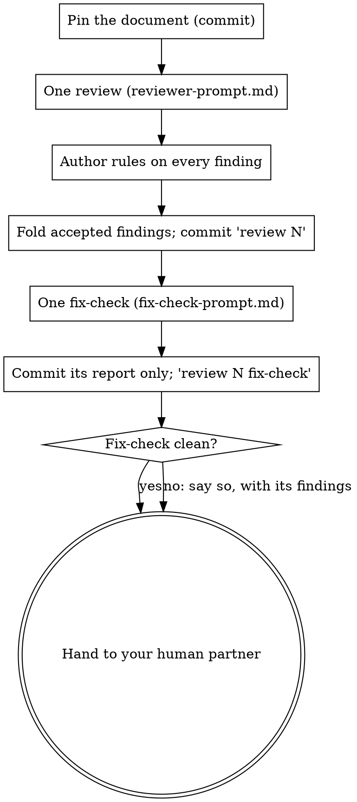

# Reviewing Documents

## Overview

A document review is one round with an end, not a loop that runs until the reviewer runs dry. A reviewer told to find something always finds something, and an author who folds everything gives it more text to find things in. Rounds stop converging, while the real defects hide among the padding.

**Core principle:** report only what is verified and consequential, rule on every finding, and stop after one fix-check.

Code diffs are not documents: for those use superpowers:requesting-code-review. A code reviewer (including a native `/code-review`) used on a plan inherits a diff reviewer's quota and finds problems in prose that has no behaviour to test.

## The round

**Pin the input.** The review reads the document at one commit, named in the brief, and not later versions of it or of what it builds. If the document or anything it rests on (its spec, ticket, ruling) changes while the review runs, the round is void: re-dispatch on the new commit, don't patch the old findings onto it.

**One review.** Dispatch a fresh reviewer with [reviewer-prompt.md](reviewer-prompt.md). Give it the document's recorded rulings: rejected findings with their reasons, and decisions the document records. A ruled item comes back only with new evidence. Every item in the review's Unverified section gets a verdict like a finding: settled by its check, backlogged, or listed for the human. None is dropped.

**Rule on every finding.** See *The author's half*.

**One fix-check, then the human.** Dispatch [fix-check-prompt.md](fix-check-prompt.md) with the findings, your verdicts and the fold diff. It checks that each accepted finding is resolved and that the fold broke nothing in the text whose meaning it changed. It cannot raise new findings on text the fold neither touched nor changed the meaning of. What it notices there, starting with the same problem repeated elsewhere, goes to the human with the round. Its commit carries its report and verdict only, never a fold. Whatever it returns, the round ends with your human partner: show them the verdict tally, any open fix-check finding, the unverified items listed for them, and what the fix-check noticed outside its scope.

**There is no review N+1 inside a round.** A failed fix-check is the second failed round: report it and stop, without folding its findings. Another full review, or the fold for those findings, is the human's call, on a document they have read.

**Limits.** This round trades some recall for precision. A precise reviewer reports fewer findings than one that lists everything, and in testing it missed small mechanical defects a list-everything review caught. The fix-check checks the fold, not the rest of the document, so a serious defect the one review missed, in text the fold didn't touch, reaches the human only as an *outside this check* line or not at all. When the stakes are high, the human can ask for a fresh review; that is a new round, by their decision.

## The author's half

**REQUIRED SUB-SKILL:** Use superpowers:receiving-code-review. Its rules apply to document findings as that skill states them: verify before acting, no performative agreement, handle unclear items the way it says before folding any, trust by source, push back with technical reasoning. Then add these:

**A verdict for every finding**, written down:

| Verdict | When | Recorded as |
|---|---|---|
| accept | Verified real, and resolving it is in this document's scope | The fold, plus one line in the commit body |
| reject | Wrong, already ruled, or not worth its cost; give the reason | One line with the reason; it stays on record for the next reviewer |
| backlog | Real, but outside this document or this round | Where it went (ticket, backlog file, the note to your human partner) |
| ruling | Real, and resolving it changes a recorded decision | A question to the decision's owner, asked before folding (see below) |

Put the tally in the commit body (`accept 3, reject 2, backlog 1, ruling 0`). Rejections are the reviewer's false alarms. The rate (rejected ÷ reported) means something only over many findings, so judge the reviewer prompt on the running count across reviews, not on one round.

**The reviewer's proposed fix is evidence of the problem, not the fix.** Derive the fix yourself from the finding's consequence and check it before folding. A proposed setting, flag or API that you haven't seen work is a guess.

**Design that can run is settled by running it.** When a finding turns on how a tool, API, library or system behaves, answer it with a spike or test, and put the result in the document. Don't write the answer as prose. Prefer a local fake or a scratch copy; when the question is about a real service's behaviour and the spike has to call it, say so in the report, with what it cost.

**A finding that asks for more than the document's spec asks for gets the YAGNI check.** A new path, section or option nobody asked for is rejected or backlogged, not folded.

**Fold only what the findings ask.** Problems you notice yourself while folding go to the backlog, not into this round's diff.

**A change to a recorded decision is a ruling, not a fold.** If accepting a finding changes the spec, a ruling, or a decision the document records, ask the decision's owner (your human partner, or whoever they name) before folding it, with the finding and your recommendation. Fold the other findings meanwhile; don't rewrite the decision until they answer, and never quietly in the same commit as the typo fixes.

**Name the round in the commit subject**, so a round counter can read it: `docs(plan): <document> review N — 
`, and `docs(plan): <document> review N fix-check — 
` for the fix-check's commit, which is part of round N, not a new round. N is the highest review number the document's commit subjects already use, in any form (digits, `review round N`, or ordinal words such as `the sixth review`), plus one; or 1 if there is none. Rounds that were never numbered don't count.

## Trusting a reviewer

Before you rely on a reviewer prompt, run it once on a **negative control**: a document that was accepted and has needed no change since. Findings there that you reject are its baseline false-alarm rate. Track rejected ÷ reported across rounds; when it runs above about one in ten, fix the reviewer prompt. Don't mute it or stop reading it.

## Red flags

| Thought | Reality |
|---|---|
| "The reviewer will check the fix in round N+1" | Round N+1 reads the whole document again and finds new things. The fix-check checks the fix. |
| "The reviewer proposed the fix, so it's reviewed" | Nobody ran it. Derive and check it yourself. |
| "While I'm in here I'll fix these other things" | Unasked changes are unreviewed changes. Backlog them. |
| "The owner will approve the spec change anyway" | Then asking costs them one line. Rewriting it silently costs the record. |
| "Declined" | Declined to where? Reject with a reason, or backlog with a place. |
| "Clean round, but the reviewer listed lows" | Lows without a consequence are padding. Reject or backlog them, and count them. |
